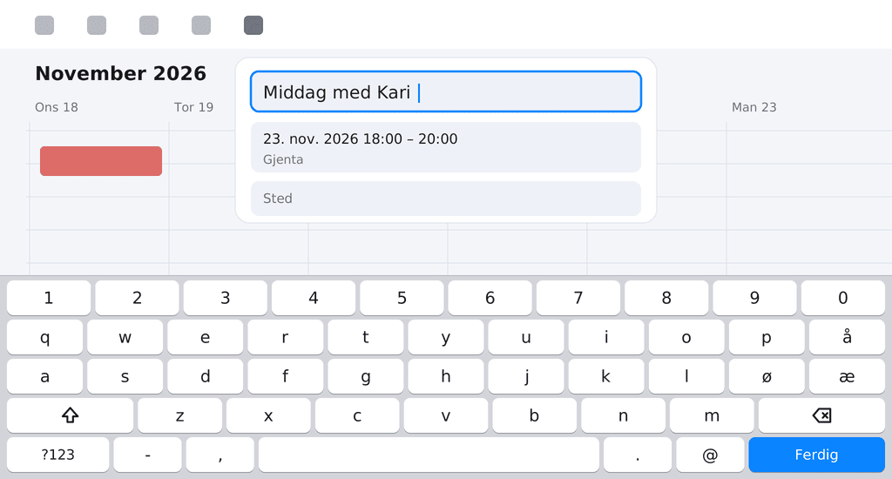
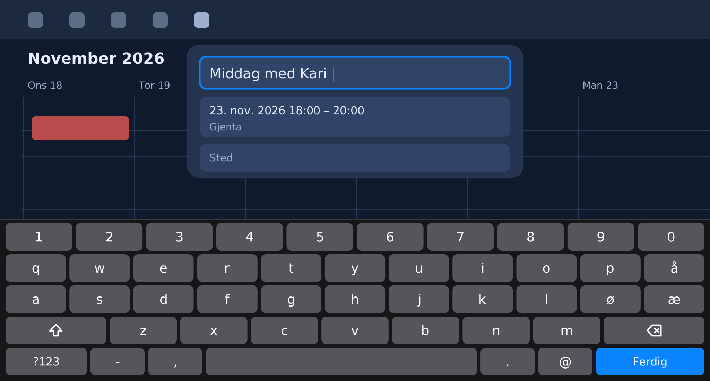
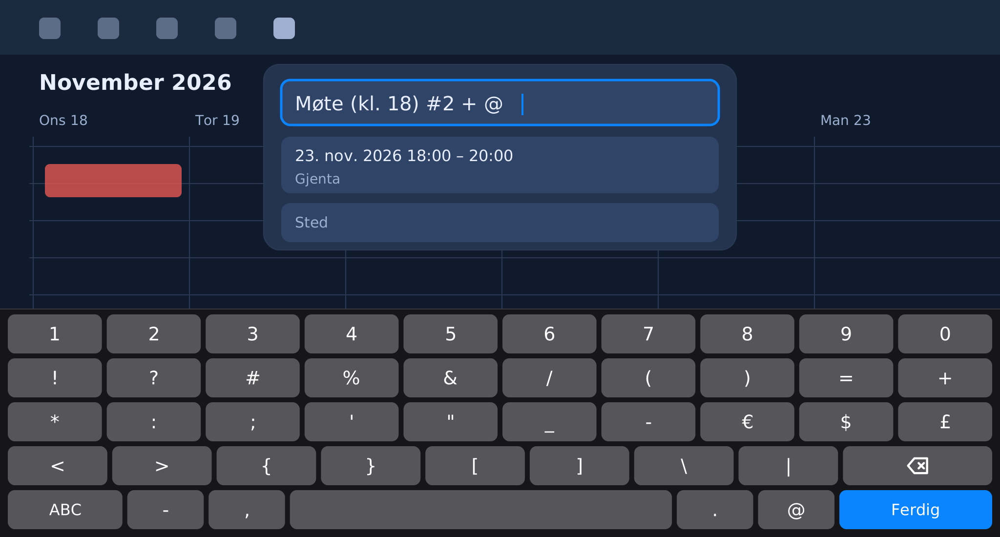

# Cast Keyboard

An on-screen keyboard for Home Assistant dashboards on devices that have no usable
keyboard, such as **Nest Hub / Google Cast**.

Tap any text field (for example "Summary" when adding an event in a calendar card)
and a keyboard appears at the bottom of the screen.

## Features

- Appears automatically on Google Cast. It does nothing on normal browsers and phones.
- Works inside dialogs and popovers, where most keyboards on top of the page fail.
- Follows your Home Assistant language: English, Norwegian, Danish, Swedish, Finnish,
  German, Dutch, French, Spanish, Italian, Portuguese, Polish and Russian.
  Unsupported languages fall back to English.
- Light or dark keyboard that follows your Home Assistant theme.
- Shift / caps lock, numbers and symbols, `@` and `.` for e-mail and URLs.

## On a Nest Hub

The light version of the keyboard

The dark version of the keyboard

Here showing the symbol view

## Installation

### HACS (recommended)

1. In HACS, open the menu (⋮) and choose **Custom repositories**.
2. Add `https://github.com/grotteru/cast-keyboard` with category **Dashboard**
3. Search for **Cast Keyboard**, install it, and reload your browser.

HACS adds the resource for you. To check it, open Settings → Dashboards → three dots → Resources. You should see this entry:

| URL | Type |
| --- | --- |
| `/local/community/cast-keyboard/cast-keyboard.js` | JavaScript module |

If it is missing, add it with exactly that URL and type.

### Manual

Copy `dist/cast-keyboard.js` to `/config/www/` and add `/local/cast-keyboard.js`
as a JavaScript module resource under Settings → Dashboards.

## Usage

Cast a dashboard to your Nest Hub and tap a text field. To test on a PC or phone,
add `?osk=1` to the dashboard URL.

## Options

All options are optional.

| Where | Option | Effect |
| --- | --- | --- |
| Dashboard URL | `?osk=1` | Always show the keyboard (testing) |
| Dashboard URL | `?osk=0` | Turn the keyboard off |
| Dashboard URL | `?osklang=de` | Force a language |
| Dashboard URL | `?oskdebug=1` | Log the chosen placement in the browser console |
| Resource URL | `?lang=de` | Force a language for everyone |
| Resource URL | `?force=1` | Show the keyboard on all devices |

Supported language codes: `en`, `nb` (also `no`/`nn`), `da`, `sv`, `fi`, `de`, `nl`,
`fr`, `es`, `it`, `pt`, `pl`, `ru`.

Note: HACS may rewrite the resource URL when it updates the card, which can remove
`?lang=` and `?force=`. Prefer the Home Assistant language setting, or the dashboard
URL options.

## Troubleshooting

- **Nothing appears:** hard-reload the dashboard, check that the resource is listed
  with type *JavaScript module*, and try `?osk=1&oskdebug=1` on a PC.
- **The device's own keyboard also appears:** report it with your device model.
- **Wrong placement inside a dialog:** open an issue with the `?oskdebug=1` console output.

## How this was made

I'm not a developer, and I used [Claude](https://claude.ai) to help me create the code. I was also inspired by the work of @mngrrt on the [touch-music-card](https://github.com/mnrgrrt/touch-music-card). 

My goal was to create a functional keyboard that could be used with other Home Assistant cards as well, such as calendar cards. This gave me the idea to try building a plugin that could work universally with anything cast to a Google Nest Hub.With the help of AI, I managed to get it working surprisingly well.

Please keep in mind that the source code should be considered AI-generated code.

## License

MIT. See [LICENSE](LICENSE).
